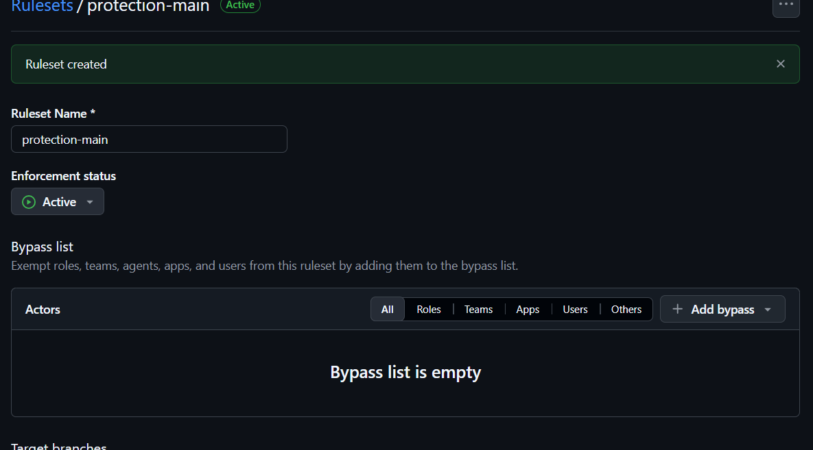

   ## Stratégie de branches

Le projet suit **GitHub Flow** :

- `main` est la seule branche permanente. Elle est **toujours stable et déployable** :
  chaque fusion dans `main` déclenche le déploiement automatique sur le serveur EC2.
- Chaque évolution est développée dans une branche courte, créée depuis `main` :
  `feature/<sujet>` pour une fonctionnalité, `fix/<sujet>` pour une correction,
  `docs/<sujet>` pour la documentation.
- Toute modification arrive dans `main` uniquement par une **Pull Request**.
  Le push direct et le force-push sur `main` sont interdits par une règle de protection.

### Intégration continue

Une pipeline GitHub Actions est lancée automatiquement :

- **à chaque push, sur n'importe quelle branche** : le développeur sait immédiatement
  si son code est correct, sans attendre l'ouverture d'une Pull Request ;
- **à chaque Pull Request vers `main`** : le code est vérifié tel qu'il sera une fois
  fusionné.

La pipeline vérifie que le code est correct avant qu'il n'atteigne `main` :

1. **Lint** (`ruff check .`) : respect des règles de style et détection d'erreurs courantes ;
2. **Tests** (`pytest`) : bon fonctionnement de l'API ;
3. **Scan de sécurité** (Trivy) : absence de dépendances vulnérables et de secrets
   dans le code.

Une Pull Request ne peut être fusionnée que si la pipeline est **verte**. Un code qui
casse les tests ou introduit une faille ne peut donc jamais arriver sur `main`, ni
être déployé.

### Convention de commits

Les messages suivent **Conventional Commits** : `type(portée): description`
(ex. `feat(api): ajouter la route /version`, `fix(deps): mettre à jour

### rulests

