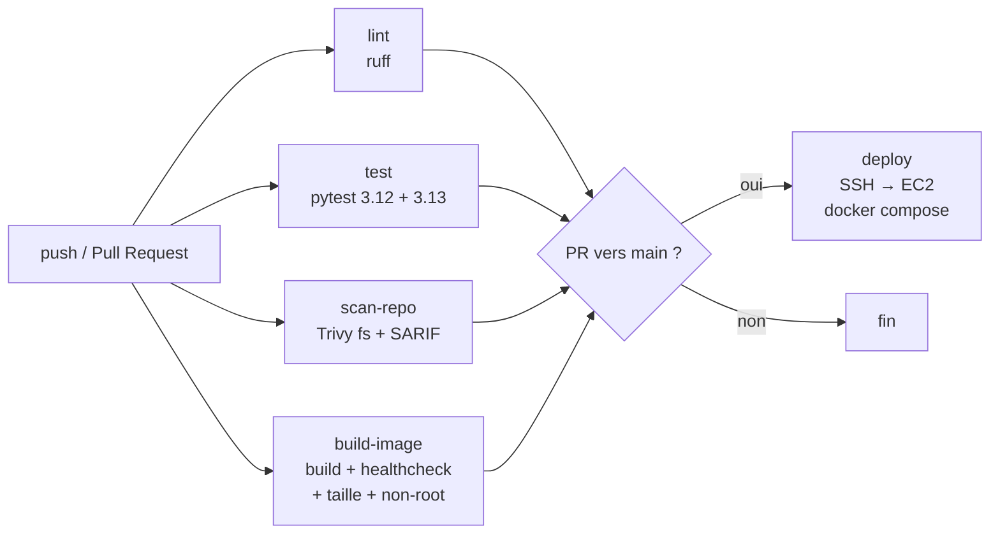
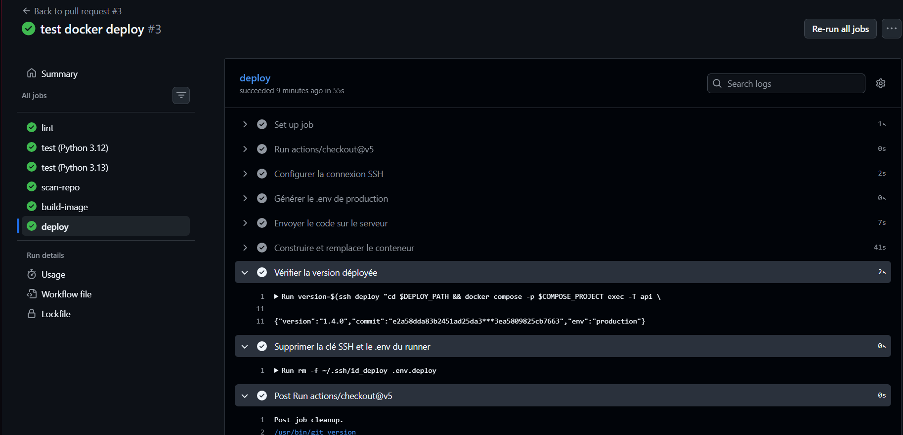
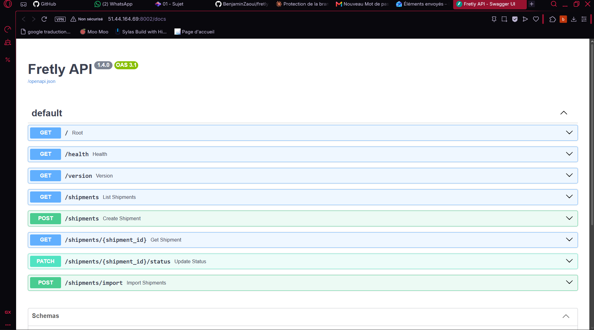

# Fretly API

API de suivi d'expéditions (FastAPI, SQLAlchemy, PostgreSQL), conteneurisée avec Docker et
déployée automatiquement par GitHub Actions sur un serveur EC2.

```bash
cp .env.dist .env                 # puis remplir les valeurs
docker compose up --build         # API sur http://localhost:8002/docs
```

---

## 1. Stratégie Git et protection de `main`

Le projet suit **GitHub Flow** :

- `main` est la seule branche permanente, **toujours stable et déployable**.
- Chaque évolution se fait dans une branche courte créée depuis `main` :
  `feature/<sujet>`, `fix/<sujet>`, `docs/<sujet>`.
- Le code arrive dans `main` **uniquement par Pull Request**.
- Les messages de commit suivent **Conventional Commits** : `type(portée): description`
  (ex. `feat(api): ajouter la route /version`, `fix(deps): mettre à jour python-multipart`).

**Règles de protection de `main`** (ruleset `protection-main`, actif, aucune exception) :

| Règle | Effet |
|---|---|
| Pull Request obligatoire | Aucun push direct sur `main` |
| Force-push interdit | L'historique de `main` ne peut pas être réécrit |
| Suppression interdite | `main` ne peut pas être effacée |
| Checks obligatoires | La PR ne peut être fusionnée que si la pipeline est verte |
| Liste d'exceptions vide | Les règles s'appliquent aussi aux administrateurs |

---

## 2. Dockerfile

| Point | Choix |
|---|---|
| Image de base | `python:3.12.16-slim-trixie` : version explicite (jamais `latest`), variante *slim* (sans compilateurs ni outils inutiles), Debian 13 récente donc moins de CVE |
| Multi-étapes | `builder` installe les dépendances dans un virtualenv ; l'étape finale ne reçoit que le virtualenv et le dossier `app/` |
| Taille obtenue | **≈ 192 Mo** (< 200 Mo) : installation sans `.pyc` (`--no-compile`), pip retiré du virtualenv, pas de cache pip |
| Utilisateur | `fretly` (uid 10001), **non root** ; le code appartient à root, l'application ne peut pas le modifier |
| Healthcheck | `HEALTHCHECK` sur `/health` (vérifie aussi l'accès à la base), en Python : pas besoin d'installer `curl` |
| Traçabilité | Le commit Git est passé en `--build-arg GIT_COMMIT` et renvoyé par `/version` |
| Contexte de build | `.dockerignore` exclut `.git`, `.env`, les tests, les caches et les environnements virtuels |
| Scans | `trivy config` : 0 HIGH/CRITICAL ; `trivy image --ignore-unfixed` : 0 HIGH/CRITICAL |

Port : l'API écoute sur **8000** dans le conteneur, publié sur le port **8002** de l'hôte.

---

## 3. Pipeline CI/CD



**Quel job s'exécute sur quel événement :**

| Job | Push sur `main` / `branch-benja` (`ci.yml`) | Pull Request vers `main` (`ci-pr.yml`) |
|---|:---:|:---:|
| `lint` : Ruff | X | X |
| `test` : Pytest (Python 3.12 et 3.13), rapports JUnit et couverture | X | X |
| `scan-repo` : Trivy fs, bloquant sur HIGH/CRITICAL corrigeables, SARIF dans l'onglet *Security* | X | X |
| `build-image` : build Docker, taille < 200 Mo, healthcheck, `/version`, non-root | X | X |
| `deploy` : SSH vers l'EC2, rebuild et remplacement du conteneur |  | X (si tous les jobs précédents sont verts) |

Le job `deploy` copie le code sur le serveur, génère le `.env` à partir des secrets, reconstruit
l'image, remplace l'ancien conteneur (`--force-recreate`), attend qu'il soit `healthy`, puis
vérifie que `/version` renvoie bien le commit de la PR.

---


## 5. Questions

### Pourquoi bloquer uniquement sur les vulnérabilités corrigeables (`--ignore-unfixed`) ?

Parce que bloquer doit mener à une action. Si aucun correctif n'existe, le développeur ne peut
rien faire : la pipeline resterait rouge indéfiniment, et l'équipe finirait par contourner ou
désactiver le contrôle.

**Risque restant :** des failles connues mais non corrigées restent dans l'image, et peuvent
être exploitées.

**Suivi :** le scan non bloquant publie **toutes** les failles, y compris non corrigées, dans
l'onglet *Security* (SARIF). On les surveille, on reconstruit régulièrement l'image pour
récupérer les correctifs dès leur sortie, et on évalue au cas par cas si le code vulnérable
est réellement utilisé.

### Pourquoi scanner l'image avant de la publier plutôt qu'après ?

Parce qu'une image publiée peut être téléchargée et déployée immédiatement. Scanner après,
c'est découvrir le problème quand l'image vulnérable est déjà disponible, voire en production.
Scanner avant garantit que **seules des images validées existent dans le registre** : le
registre devient une source de confiance.

### Pourquoi déployer le tag `sha-…` plutôt que `latest` ?

- **Immuable :** `sha-abc123` désigne toujours la même image, alors que `latest` change à
  chaque build.
- **Traçable :** on sait exactement quel commit tourne en production (`/version` le confirme).
- **Retour arrière simple :** il suffit de redéployer le tag `sha-` précédent.
- **Pas d'ambiguïté :** avec `latest`, deux serveurs peuvent faire tourner deux versions
  différentes sous le même nom, selon le moment de leur `pull`.

### Sur un serveur partagé, que donne réellement le groupe `docker` ?

**L'équivalent des droits root sur la machine.** Un membre du groupe `docker` peut lancer
`docker run -v /:/host --privileged …` et lire ou modifier n'importe quel fichier de l'hôte.
Il peut aussi voir, arrêter ou entrer dans les conteneurs des autres utilisateurs, et lire
leurs secrets avec `docker inspect`.

**Architecture proposée en production :**
- un serveur ou une VM **dédiée** à l'application, pas de serveur partagé ;
- Docker en mode **rootless** (ou Podman) ;
- images construites en CI, scannées, publiées sur un registre et **tirées par tag `sha-`** ;
  le serveur ne compile plus rien ;
- pas de clé SSH longue durée dans GitHub : connexion via **OIDC** et un rôle AWS (par
  exemple SSM) ;
- à plus grande échelle, un orchestrateur géré (ECS, Kubernetes).

---

## 6. Captures

| Capture | Fichier |
|---|---|
| Run complet vert, avec déploiement |  |
| PR `demo/cve` bloquée par Trivy | *à ajouter* |
| Protection de `main` |  |
| Paquet sur ghcr.io | *à ajouter* |
| API servie sur l'EC2 (`http://<ip>:8002/docs`) |  |

---

## 7. Limites et améliorations

| Limite actuelle | Amélioration |
|---|---|
| L'image est publiée sur **ghcr.io** (tag `sha-…`) mais encore reconstruite **sur le serveur** à chaque déploiement | Tirer sur le serveur l'image `ghcr.io/…:sha-…` déjà construite et testée en CI, au lieu de la recompiler |
| `trivy image` n'est lancé qu'en local | L'ajouter dans la pipeline avant publication, bloquant sur HIGH/CRITICAL corrigeables |
| Image non signée | Signer avec **cosign** et vérifier la signature avant déploiement |
| Clé SSH stockée dans les secrets GitHub | **OIDC** vers AWS, sans secret longue durée |
| Déploiement direct depuis la PR, sans recette | Un **environnement de recette** (staging), puis la production après approbation manuelle |
| Seuls des tests unitaires et d'API | Ajouter un **DAST** (OWASP ZAP) sur l'environnement de recette |
| Pas de retour arrière automatique | Garder le tag précédent et revenir dessus si le healthcheck échoue |
| Pas de supervision | Logs centralisés et alertes sur `/health` |
